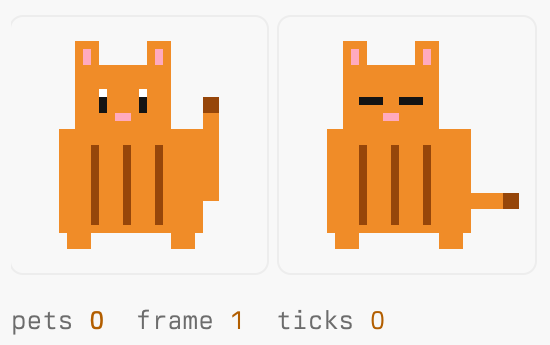
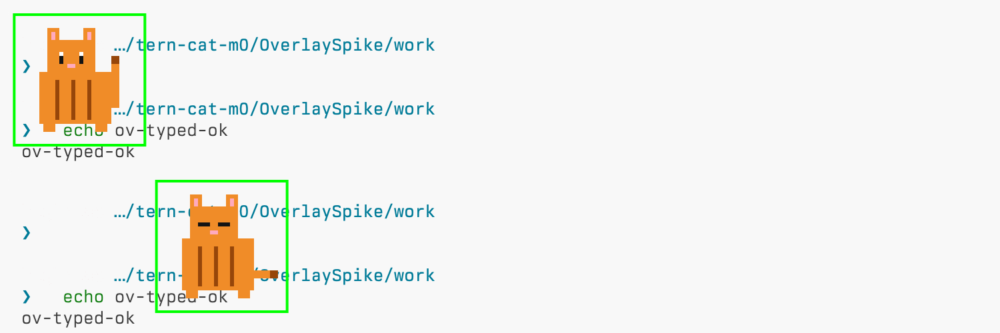

# SDK capability matrix (M0)

Target: Tern `0.6.2 (4b3ed42)` on macOS arm64. The API types came from `tern plugin types` (`tern.d.luau`, 1814 lines). Line references point into that file. Re-checked against Tern `0.8.3 (e2b8656)` and `0.9.16 (41a10a5)`: see [Tern 0.8.3 delta](#tern-083-delta) and [Tern 0.9.16 delta](#tern-0916-delta).

Tags:

- **VERIFIED**: observed in a sandboxed experiment, or quoted from the installed types or the docs URL named.
- **INFERENCE**: reasoning that has not been tested.

Docs root: https://docs.stencil.so/tern/

Experiments:

- **RenderSpike**: a block that renders a PNG/APNG sprite.
- **OverlaySpike**: a window-half CSS decoration plus a floated block.

Both ran against an isolated config, daemon and log directory (see [Dev isolation](#dev-isolation-recipe)).

## Summary

| # | Question | Answer | Tag |
|---|---|---|---|
| 1 | Do host hooks see terminal data? | Metadata only: command line, status, duration, cwd, title, pane exit | VERIFIED |
| 2 | Can a plugin draw an interactive image over arbitrary panes? | Decorative, non-interactive: yes, through window-half global CSS. Interactive: only inside a block, which can be floated into a pane corner | VERIFIED |
| 3 | Can a plugin read grid geometry and put a sprite on an `ls` glyph? | No. There is no cell geometry API. Text read-back exists, but it has no coordinates. See the upstream RFC | VERIFIED (absence) |
| 4 | Pointer, drag, focus/visibility, multi-window, frame callbacks? | Click, double-click and menu per node only. No hover, move, drag or frame callback. Window `focus` event and CSS-only visibility classes. Each window gets its own session | VERIFIED |
| 5 | Images, blobs, fps, hit-testing, sound? | PNG/APNG/GIF/WebP blobs (SHA-256 ids); ~10 fps is cheap; node-level click; no audio API | VERIFIED |
| 6 | One shared per-user cat model? | `tern.kv` (shared by both halves, all windows and all daemons on one config dir). No lock and no change notification, so use a single writer | VERIFIED |
| 7 | Consented autonomous Carly inference? | Exports and context work. There is no hidden completion API. A scheduled turn is a full-power Carly turn | VERIFIED |
| 8 | API version and CLI routes | No API version field. `plugin types/link/list/reload`, `tern shot`, `tern --control` | VERIFIED |

**Rendering decision:**

- The interactive cat is a **block**, opened on request. The preferred presentation is a **floated corner card** (`cx.layout:float`), with a normal split/tab block as the fallback.
- A **decorative overlay** cat is drawn with window-half `tern.css` and is on by default (hide/snooze via command, keybind or config). It is per-window, `pointer-events: none` and never interactive.
- Neither surface is a "global overlay renderer" in the compositor sense.



*Block render.* This is a headless `tern shot` with `remote loopback`. Left: the PNG frame swapped by Lua. Right: the APNG, pinned to frame 2 with `freeze-anims` + `motion-at 150`.



*Window-half CSS decoration.* The image pairs two shots taken about 1 s apart. The cat walked and changed frame over a live prompt. The green boxes are annotations added when the shots were composited. The hostname has been redacted.

## 1. Host hooks

| Item | Detail | Tag |
|---|---|---|
| Answer | Host hooks deliver shell metadata only | VERIFIED |
| Events, host half | `command_started`, `command_finished`, `cwd`, `title`, `pane_exited`, `spawn` (types L1767-1773) | VERIFIED |
| Events, window half | `window_start`, `focus`, `pane_created`, `pane_closed`, `tab_created`, `tab_closed`, `command_started`, `command_finished`, `cwd`, `title`, `canvas_action` | VERIFIED |
| Payload | `CommandFinishedEvent = { pane, line, status, took_ms }` (L1063-1072); no output text | VERIFIED |
| RenderSpike evidence | A host `command_finished` hook fired in the daemon, wrote `tern.kv` and re-rendered the live block | VERIFIED |
| Requirement | Command events need shell integration (OSC 133); see [guides/hooks](https://docs.stencil.so/tern/guides/hooks.html) | VERIFIED |
| Remote panes | A remote host runs its own host halves. The local host half never hears about remote panes, but the window half does | VERIFIED (docs) |
| Output text elsewhere | Window `cx.session:read(pane, opts)` returns up to 2000 lines, 64000 chars, scrollback on by default, with no coordinates. tern-cat never calls it on shell panes | VERIFIED |
| Budgets | Host 2 s per call; window 50 ms; formatters and `available` 4 ms. A tripped budget disables the hook until reload (0.9.6 and later: pauses it; see [Tern 0.9.16 delta](#tern-0916-delta)) ([concepts/runtime](https://docs.stencil.so/tern/concepts/runtime.html)) | VERIFIED |
| Decision | Count command events in the host half only. Never read `line` into any outbound payload | - |

## 2. Drawing over panes

| Item | Detail | Tag |
|---|---|---|
| Overlay or decoration API | None in the types or the docs. A block's `layer` is drawn inside that block only | VERIFIED |
| Global CSS | `tern.css(name, src)` from the window half draws `position: fixed; z-index: 2147483647; pointer-events: none` pseudo-elements (`#panel::after`, `:root::after`, `body::after`, `#tabbar::after`) above panes, PiP cards and the tab bar | VERIFIED (OverlaySpike) |
| Images in CSS | Plugin-relative `url(sheet.png)` and `data:image/png;base64,…` both work. An APNG used as a CSS background shows only its first frame | VERIFIED |
| Animation | `@keyframes` translate plus `steps(N)` on `background-position` over a sprite sheet. `ctl stats` reports the element as animating | VERIFIED |
| Input pass-through | `ctl pick` under the cat hit `div.tv-rows`. With `pointer-events:auto` the same pick hit the pseudo box. A click under the cat focused `textarea.tv-input`. A selection dragged across the cat included the hidden characters. Typing and Enter ran the command | VERIFIED |
| Content unchanged | `cx.session:read(pane,{lines=60})` returned identical results with the overlay on and off | VERIFIED |
| Scope | A `tern.css` sheet exists only in the calling window's VM. Manifest `styles` apply in every window. The docs say both are machine-wide, but the experiment shows `tern.css` is per-window | VERIFIED (docs differ) |
| Reload | A sheet installed from a command handler is dropped on reload. A sheet installed at entry load survives. `tern.css(name, "")` leaves an empty sheet in place | VERIFIED |
| Follow focus with zero Lua | `section.tn-pane.on > .tn-body::after { position:absolute; right:12px; bottom:12px }` follows the focused pane across `split` and `focus` | VERIFIED |
| Interactivity | No input reaches the window half (no DOM or class API). CSS-only: a `pointer-events:auto` pseudo-element on `.tv > .tv-fx.top` (itself `pointer-events:none`) gives that host a cat-local `:hover`/`:active` while clicks, drags, typing and mouse reporting still reach the terminal (later spike; used by the overlay's pointer reactions) | VERIFIED |
| Floated block (PiP) | `cx:new_block(kind, args, "beside")` then `cx.layout:float(pane, owner, "br")` gives a 465x278 CSS px card (59x14 cells) over the owner. The owner keeps 160x45 cells and keeps keyboard focus. A single click does not steal focus. Tern 0.8 changed this: see [Tern 0.8.3 delta](#behavior-changes) | VERIFIED |
| Float limits | The plugin can set only the corner. `layout:resize` on a float returns `false`; only the user can resize it. `how="pip"` raises. The host `resize` hook did not fire for a float, and `cx.cols`/`rows` stayed at 80x24 | VERIFIED |

### Decision and rationale

**Interactive cat:** a block, opened on request and floated into a pane corner by default.

- It is the only surface that receives clicks. Click to visible took about 16-29 ms, including ctl overhead (RenderSpike).
- It does not take the owner pane's focus or reflow its content.

**Decoration (on by default):** window-half `tern.css`.

- It is per-window.
- It is non-interactive and passes input through.
- Terminal content is unchanged.

**CPU of the decoration** (OverlaySpike, window process, % of one core):

| Motion | CPU % | fps |
|---|---|---|
| Static | 0.0 | 0 |
| Smooth `linear` walk | 12.9 | 80 |
| `steps(100)` over 10 s (10 Hz) | 2.0 | 10 |
| Lua re-installs a `pos` sheet every 100 ms | 5.8 | - |
| `transition … steps(30)` waypoints | ~1.4 (lower bound) | - |
| `reduce_motion=on` | 0.17 | 0 |

**Design rule:** quantize every motion with `steps()`. Never use smooth transitions; they render at display rate.

**Reduced motion:**

- Tern's `motion.css` zeroes animation and transition durations under `prefers-reduced-motion`.
- Tern's `reduce_motion` setting drives that media query in plugin sheets.

VERIFIED.

## 3. Grid geometry and the `ls` glyph gag

| Item | Detail | Tag |
|---|---|---|
| Cell, glyph, cursor or font metrics | None. A grep of the types for `overlay`, `grid`, `geometry`, `pixel`, `sprite`, `hit.?test`, `pointer` and `mouse` finds no geometry API. `TabLayout` gives split ratios only | VERIFIED |
| Text read-back | `cx.session:read` returns line strings with no screen row or column. Screen position could only be guessed | VERIFIED / INFERENCE (guess) |
| CSS reaching glyphs | No selector targets terminal cells. INFERENCE: the grid is drawn as rows, not per-glyph elements | INFERENCE |
| Decision | The `ls` gag is a parody inside the cat's own block. Upstream proposal: [overlay-upstream-rfc.md](overlay-upstream-rfc.md) | - |

## 4. Pointer, focus, visibility, windows, frame callbacks

| Item | Detail | Tag |
|---|---|---|
| Pointer | Per-node `actions = {click, dblclick, menu}`, giving `{ev="action", id, act, value?, mods?}`. Docs: "Hover, scrolling, text selection, tooltips and the context menu are Tern's own." No move, hover, drag or wheel events ([protocol/input](https://docs.stencil.so/tern/protocol/input.html)) | VERIFIED |
| Keyboard | `key(state, key, cx)` only while the block has focus. `tern.bind` and command `keys` are window-wide. Chords already bound are dropped with a warning | VERIFIED |
| Window focus | The window `focus({pane, tab})` event covers pane/tab focus, not OS window focus | VERIFIED |
| Visibility | CSS-only region classes: `.sf-paused` (surface not visible), `.sf-still` (reduced motion), `.sf-unfocused`. `cx.session:view(pane)` returns nil when hidden. No occlusion, minimize or battery signal | VERIFIED |
| Hidden cost | A Lua-timer block keeps sending frames while hidden: window 0.84 % plus daemon 0.9 %. An APNG costs about 0 when hidden. The cat must throttle itself | VERIFIED |
| Frame callbacks | None; the only option is `tern.timer`. A 100 ms timer measured 9.6 swaps/s | VERIFIED |
| Multi-window | Each window process gets its own session on the shared daemon. `window_start` fires per window, and each window's block is a separate pane. A reopened window adopts an orphaned session | VERIFIED |
| Window identity | No window id exists. `TERN_WINDOW_KEY` is nil in a clean env. Discriminators: the current session id from `cx.session:sessions()`, or a random id generated at load (it changes on every reload) | VERIFIED |
| Reload | `window_start` does not fire again on reload. Window halves lose all Lua state, so per-window state must be rebuilt at entry load | VERIFIED |
| Mirroring one session in two clients | Documented ([concepts/architecture](https://docs.stencil.so/tern/concepts/architecture.html)), not reproduced (no web client assets) | BLOCKED |

**Multi-window verdict:** windows use separate sessions. Each window opens its own cat block from `window_start`. All of them read one shared profile from `tern.kv`.

## 5. Images, blobs, frame rate, hit-testing, sound

| Item | Detail | Tag |
|---|---|---|
| Image node | `tern.ui.node("image", {blob = cx:blob(bytes, "image/png"), w, h})`. There is no `ui.image` builder. `image-rendering: pixelated` comes from manifest CSS | VERIFIED |
| Formats | PNG, JPEG, GIF and WebP up to 4096 px per side; SVG up to 256 KiB. An animation over 1024 frames or 64 MiB of decoded pixels shows only its first frame ([elements/data](https://docs.stencil.so/tern/elements/data.html#image)) | VERIFIED (docs) |
| Blob ids | The id is the SHA-256 of the bytes, so re-sending the same bytes is idempotent | VERIFIED (docs) |
| APNG | Plays on the window animation clock. `freeze-anims` + `motion-at` pins it deterministically | VERIFIED |
| Late-attach hazard | When a frame swaps one node's `blob`, a window that attaches later shows the "missing" placeholder. Fix: keep every frame node in the view and toggle a `role` hidden by CSS | VERIFIED |
| Cost | One 10 fps animated sprite in a visible window costs about 3-3.5 % (subtraction estimate). Paused and hidden costs about 0.2 % | VERIFIED (measured) / INFERENCE (per-sprite split) |
| Hit-testing | Per node only; a node `click` action replaces the image's built-in zoom | VERIFIED |
| Limits | Messages over 64 KiB are chunked. At most 8 `cx` render rounds per handler. VM 256 MiB ([reference/limits](https://docs.stencil.so/tern/reference/limits.html)) | VERIFIED (docs) |

**Sound verdict:** Tern has no audio API.

- The types contain no `audio`, `sound`, `play` or `beep` (VERIFIED).
- `cx:toast` is silent.
- Companion approach: run `tern.process.run({"afplay", "-v", volume, path}, {timeout_ms}, cb)` on macOS, or `pw-play`/`paplay`/`aplay` on Linux. `tern.process.run` is available to both halves; tern-cat runs it only from the host half (`host.luau` → `cat/integrations/sound.luau`), so sound plays once per user rather than once per window.
- OverlaySpike confirmed the call from the window half returns in about 1 ms with the callback after about 1.45 s (played at volume 0). A missing binary raises synchronously (VERIFIED).
- Sound is muted by default; this is self-imposed, because Tern has no permission prompt.

## 6. Shared per-user cat model

| Item | Detail | Tag |
|---|---|---|
| `tern.kv` | JSON values in `<config>/plugin-data/<id>/kv.json`. Shared by both halves, every window, and every daemon using the same config dir (loopback, standalone and `tern shot` daemons all saw the same data). Each VM re-reads the file when its mtime or length changes | VERIFIED |
| Concurrency | `set` writes the whole file atomically (temp file plus rename). "Two VMs setting at the same moment still race: the later rename wins." No lock, CAS or change notification | VERIFIED (docs) |
| `tern.fs` | Unrestricted paths. Writes are not atomic. No rename, stat or watch | VERIFIED (docs) |
| Block `save` | Stored with the pane in `<TERN_DAEMON_SOCKET>.state`. It survives a daemon restart and is per pane, not per user | VERIFIED |
| Host half | One VM per plugin per daemon (one daemon per user). In-memory state dies on reload | VERIFIED (docs) |
| Window to host channel | `cx.session:event(blockPane, {ev="action", …})` fires the host block `event` in the same millisecond | VERIFIED |
| Host to window channel | Host `cx:open("scheme://…")` reaches the window's `tern.route.link`. Window to host to window took about 1.5 ms | VERIFIED |

**Storage verdict:**

- **Single writer:** the host half is the only writer of the profile in `tern.kv`, with a monotonically increasing `rev`.
- **Window intents:** windows send intents through block events, or through an `fs` inbox under `tern.plugin.data` that the host drains.
- **Readers:** windows read the profile by polling `kv.get`, which is cheap when the file has not changed.

## 7. Carly

| Item | Detail | Tag |
|---|---|---|
| Availability | Window half only, desktop only (L1541; [guides/carly](https://docs.stencil.so/tern/guides/carly.html)) | VERIFIED (docs/types) |
| `tern.carly.export` | Names match `[a-z][a-z0-9_]{0,23}`, at most 16. `sig` and `doc` are each 1-1024 bytes. Values cross as JSON. The callback runs under the 50 ms budget; `call:wait(ms)` allows up to 120000 ms. No per-call approval, so validate every argument | VERIFIED (docs/types) |
| Reply cap | **Discrepancy:** guides/carly and api-window say **16 KiB**; `ExportCall.reply` in the types says **1 MiB** (longer strings are cut). Design for 16 KiB or less | VERIFIED (both texts) |
| `tern.carly.context` | One provider per plugin. 4 ms budget. 400 chars per plugin and 1600 total | VERIFIED (docs/types) |
| `cx:ask_carly(text)` | Opens Carly with a visible question and returns nothing | VERIFIED (docs/types) |
| `tern.carly.schedule` | Recorded as `by="plugin:<id>"`. Triggers are time or window events with a `check`. Recurring model turns are at least 5 min apart. Event watches expire in 12 h by default (7 d max). At most 50 tasks. User-revocable in Settings, Carly, Scheduled | VERIFIED (docs/types) |
| Turn power | A scheduled turn is a full Carly turn: "There is no separate Carly approval or per-turn access tier." Lua, `run_command` and `send_input` are all available, so plugin prompt wording cannot enforce safety | VERIFIED (docs) |
| Hidden completion | None documented. Possible routes, all untested: polling `TaskRun.text`; `cx.agents` (a visible agent pane); a user-configured provider through `tern.fetch` | VERIFIED (absence) / INFERENCE (workarounds) |

**Carly verdict:**

- Exports and the short context string ship.
- Autonomous AI ships as a **disabled-by-default adapter** behind explicit consent, with a mock provider for tests.
- It is never marketed as constrained, because a scheduled turn is full-power Carly.

**Testing:**

- Real exports need a real window: `tern --control`, then `carly lua "return await(plugins['tern-cat'].status())"`, `carly context`, `carly task event …`, `carly task run <id> "<text>"` ([scripts/carly](https://docs.stencil.so/tern/scripts/carly.html)).
- Headless windows never start omp and load no window halves.
- These commands come from the docs and have not been executed. INFERENCE.

## 8. API version and CLI routes

| Item | Detail | Tag |
|---|---|---|
| Version | `tern --version` gives `tern 0.6.2 (4b3ed42)`. "The plugin API has no version number". Detect features with `if tern.x then` ([guides/distribution](https://docs.stencil.so/tern/guides/distribution.html)) | VERIFIED |
| Manifest | `plugin.toml`, `schema = 1`, id `^[a-z][a-z0-9-]{0,31}$`. Unknown keys are errors. No permissions field ([reference/manifest](https://docs.stencil.so/tern/reference/manifest.html)) | VERIFIED |
| Types | `tern plugin types <dir>` writes `tern.d.luau` | VERIFIED |
| Install/reload | `tern plugin link <dir>`; `tern plugin list [--json]` (validates the manifest only when no daemon is running); `tern plugin reload` (exit 1 on problems). Saving a file reloads in under 1.5 s. Block `save` state survives reload | VERIFIED |
| Opening a block | Palette "New <title> block" (works headless) or window `cx:new_block`. `tern new` has no block argument | VERIFIED / INFERENCE (`tern new`) |
| Permissions | "Tern does not declare, check or prompt for capabilities" ([concepts/security](https://docs.stencil.so/tern/concepts/security.html)). All safety rules are self-imposed | VERIFIED (docs) |
| Examples | https://github.com/stencil-hq/tern-sdk/tree/main/plugins/examples/ | VERIFIED (docs link) |

## Tern 0.8.3 delta

Re-check of everything above on Tern `0.8.3 (e2b8656)`, macOS arm64, in sandboxes under
`/tmp/tern-cat-dev/Compat083`. Sources: a diff of `tern plugin types` (2016 lines, up from 1814),
the release notes Tern bundles for 0.6.3 to 0.8.3 (palette "What's new: release notes"; there is
no public changelog), the docs (fetched 2026-10-15; they do not yet mention `agent_finished`,
`cx:pick`/`cx:prompt` or `cx.whiteboard`, which the types and release notes do), and real-window
runs: `scripts/smoke-window.sh` 19/19, `scripts/visual.sh` goldens, and manual checks with
`tern ctl`.

**Verdict:** nothing tern-cat calls changed, and every undocumented DOM/CSS hook the overlay uses
still matches. One behavior changed: Tern 0.8 floats a card as a "glance" card that takes no
clicks, so **Open cat** now focuses the card it floats. No new plugin API changes the roadmap:
still no hover/pointer events, overlay API, pane or cell geometry, window id, occlusion signal,
audio or constrained Carly completion.

### API changes in the types

| Change | Since | Effect on tern-cat | Tag |
|---|---|---|---|
| `BlockDef.features: { "edit" \| "undo" }?`: native caret, selection and undo in a block's input fields | 0.6.3 | None (the block has no text fields) | VERIFIED (types, release notes) |
| `PaneKind` adds `"canvas"` and `"carly"` | 0.6.3-0.8.x | None: tern-cat compares `PaneInfo.block` with its own kind only | VERIFIED (types) |
| `cx.canvas:open`/`set` raise on unknown fields and on an empty change (breaking) | 0.6.3 | None (`cx.canvas` unused) | VERIFIED (release notes) |
| `cx.whiteboard` (`open`, `read`, `edit`) for canvas-kind blocks | 0.6.3 | None | VERIFIED (types) |
| `cx:pick(opts)` and `cx:prompt(opts)`: a picker or a one-line field over the focused pane, resolving to the choice or text | 0.7.1 | `cx:pick` backs the Cat menu (`menu` command): items with `group`, `detail`, `icon` (Tern icon names such as `hand`, `moon`, `palette`, `pip-tr`; `fa-*` names fall back to the picker's icon) and `current`, extra fields (`act`, `arg`) come back on the chosen item, nil on Escape; `:next` callbacks get a fresh `cx`. Feature-detected (`cx.pick`); `cx:prompt` not used | VERIFIED (Tern 0.9.16 sandbox window, `ctl palette`/`picker`) |
| `agent_finished` window event (`AgentFinishedEvent = { pane, result: "done" \| "failed" \| "exited" \| "closed" }`), also a `tern.carly.schedule` watch event | 0.8.2 | Used since 0.9 with `agent_state` (`{pane, old?, new}`): agent reactions (architecture.md, ownership rule 7). Fired by a program's OSC 7501 status (`working`, `blocked` = `waiting_input`, `done`, `error` = `failed`) and its exit, only in the window showing the agent's session | VERIFIED (types, release notes; Tern 0.9.16 sandbox) |
| `cx.agents:get(spec) -> Agent` (`pane`, `Agent:tocarly("finished", message)` schedules a Carly run when the turn ends); `ask`/`wait`/`transcript`/`interrupt`/`stop` take an `Agent` | 0.8.2 | None (`cx.agents` is banned by `tests/unit/safety_spec.luau`; `tocarly` starts a full-power Carly turn) | VERIFIED (types) |
| `ExportCall:wait` returns a typed `ExportWait` marker instead of `userdata` | 0.8.x | None (tern-cat never defers an export reply) | VERIFIED (types) |
| `os.time` reads date tables as local time; `cx.db.open` opens on the focused pane's host; browser `blocks`/`release` ops | 0.7.3-0.8.0 | None | VERIFIED (release notes) |

`scripts/check.sh` (luau-lsp against the 0.8.3 types) passes without source changes. The CI
download (`stencil-hq/tern-sdk`, `plugins/tern.d.luau`) at commit `ccdb4b8266` (2026-10-12, then
`main`) is byte-identical to 0.8.3's `tern plugin types`; `scripts/fetch-types.sh` now pins that
commit so CI keeps checking against the tested version (VERIFIED).

### Capabilities on the roadmap

| Question | 0.8.3 answer | Tag |
|---|---|---|
| Pointer, hover, move, drag events for plugins | None. Block nodes still have `actions = {click, dblclick, menu}` only; the release notes' hover changes are Tern's own UI | VERIFIED (types grep for hover, pointer, mouse; release notes) |
| Overlay or decoration API | None; window-half `tern.css` remains the route | VERIFIED (types) |
| Pane geometry, cell or caret metrics | None for plugins. The 0.8.3 note "Added Stage::caret method to obtain pane caret position" is Rust-internal; nothing in `tern.d.luau` (the existing `caret` field belongs to file blocks). Possibly a future API | VERIFIED (absence) / INFERENCE (future) |
| Alternate-screen / full-screen program state | None. No `PaneInfo` field or window event; `ctl dump` and `ctl tree` of a pane running `less`, `vim -u NONE` or `top` match the prompt's except the cursor shape class (`tv-cursor.thin` at a bar-cursor prompt) and the busy dot in the pane header. `PaneInfo.program` is the running command's program as typed (`vim`, `top`; `v` for an alias of vim, `git` for `git log \| less`; `zsh` at the prompt) and `at_prompt` is `false` while a command runs; tern-cat steps the overlay aside from the `command_started` line, with those as backup | VERIFIED (types, sandbox) |
| Window id, occlusion, OS window focus | Unchanged: none | VERIFIED (types) |
| Reduced-motion signal | Unchanged: `cx.settings:get("reduce_motion")` returns `"on"`/`"off"` (polled; no event). Tern's reduced-motion CSS still stops plugin-sheet animations (`ctl stats` showed no animating element with it on) | VERIFIED (sandbox) |
| Sound | Still no audio API; `tern.process.run` + `afplay` unchanged | VERIFIED (types) |
| Constrained or hidden Carly completion | None. New: `agent_finished` watches and `Agent:tocarly`, both full-power Carly turns | VERIFIED (types) |
| Permissions, manifest | Still no permission system, `schema = 1`, no minimum-version key; `plugins: false` and per-plugin disable in `settings.json` are the controls ([concepts/security](https://docs.stencil.so/tern/concepts/security.html)) | VERIFIED (docs) |
| Budgets and limits | Unchanged: host 2 s, window 50 ms, formatters and `available` 4 ms, 256 MiB per VM ([concepts/runtime](https://docs.stencil.so/tern/concepts/runtime.html), [reference/limits](https://docs.stencil.so/tern/reference/limits.html)). tern-cat's window load: 2-3 slices, slowest 15.2-17.5 ms, overlay setup 4.0-4.9 ms (one 26.6 ms during the CPU run, logged as a warning, still under 50 ms) | VERIFIED (docs, sandbox logs) |
| First-party pet | 0.7.2 added "Desktop pet (Clawdi)" to the palette: a cat on the OS desktop that reacts to typing and scrolling anywhere (needs Accessibility and Input Monitoring) and tracks Claude Code and omp sessions, with a task-complete sound. No plugin API for it | VERIFIED (release notes, app strings) / INFERENCE (no API) |

### Undocumented DOM and CSS the overlay relies on

| Hook | 0.8.3 | Tag |
|---|---|---|
| `section.tn-pane.on:not(.off) > div.tn-body > div.tv > div.tv-fx.top` (`::after` cat, `::before` ring) | Present, box equal to the pane's view; cat drawn at all four corners; `ctl pick` on the cat reports `div.tv-fx.top>span` (the pseudo box) while the cursor stays `text` | VERIFIED |
| Hidden tabs and sessions keep `.on` and gain `.off` | Yes (headless layout `section.tn-pane.on.lone.off`); tab and session switches replay the emerge | VERIFIED |
| `div.tv-grid > div.tv-fx` (back prop), `div.tv-layer` (front prop), `--tv-px`/`--tv-py`/`--tv-aside` | Present; portal, vent and box dive in the pane losing focus and emerge in the gaining one, at bottom and top corners | VERIFIED |
| Pointer pass-through | Hover plays `look`, press plays `swat`; a press on the cat leaves the terminal input focused and typing runs; a drag across the cat selects the text under it | VERIFIED |
| `.sf-image ... .sf-img-frame` (image ring removal) | Matches (now an `img.sf-img-frame`); sprites show no frame or ring. Blocks render inside `div.tv.covered > div.tv-cover > div.sf-region.sf-main` | VERIFIED |
| PiP classes | `section.tn-pane.pip.pip-glance.pip-r.pip-b`; tern-cat does not select on them (cover detection uses `cx.session:layout(tab).floats`) | VERIFIED |

### Behavior changes

| Item | Detail | Tag |
|---|---|---|
| Floated card | `cx.layout:float(pane, owner, "br")` leaves the card in `glance` mode: tilted, 297x280 CSS px here (glance size 480x280, capped by the owner), and `ctl pick` on its buttons hits `section.tn-pane.pip` itself, so clicks on the sprite and buttons did nothing. `float(..., { focus = true })` is still glance. Double-click, `ctl pip focus` or `cx.layout:focus(pane)` switches it to `focus` mode (446x420 here; focus size 720x420), where clicks reach the block. Fix: `cat/window/blocks.luau` focuses every card it floats. The card takes keyboard focus; clicking the pane returns focus and the card to glance | VERIFIED |
| Late-attach images | 0.6.3: "block images published while the pane was hidden or before a restart show instead of 'The image data has not arrived'". tern-cat keeps every frame node in the view anyway (see [section 5](#5-images-blobs-frame-rate-hit-testing-sound)), which stays correct; dropping it would need 0.6.3 as the minimum and a re-test | VERIFIED (release notes) / INFERENCE (removal) |
| Sandbox hazard | A 0.8.3 window on a fresh config dir offered and ran "Install omp", copying `~/.local/bin/omp` into `$TERN_CONFIG_DIR/omp`. Nothing outside the sandbox changed (`~/.local/bin/omp` and the shell rc files kept their dates) | VERIFIED |

## Tern 0.9.16 delta

Re-check on Tern `0.9.16 (41a10a5)`, macOS arm64, in sandboxes under `/tmp/tern-cat-dev/Compat09`
and with `scripts/compat.sh` (types, checks, goldens, `scripts/smoke-window.sh` 19/19 and the
DOM-hook probe). Sources: a diff of `tern plugin types` (2332 lines, up from 2016), the release
notes Tern bundles for 0.8.4 to 0.9.16 (palette "What's new: release notes"; the same Markdown is
in the executable: `strings -n 1 /Applications/Tern.app/Contents/MacOS/tern`, from `## 0.9.16`
to `## 0.8.3`), throwaway plugins in a sandbox, and real-window runs with `tern ctl`.

**Verdict:** no API tern-cat calls changed (`scripts/check.sh` type-checks against the 0.9.16 types
without source changes) and every undocumented DOM/CSS hook still matches. Three behavior changes
broke tern-cat and are fixed: `at_prompt` is true while `less` runs, Tiles/Islands padding scales
with the interface size, and a budget trip now pauses timers (which stalled the window boot).
New: a window key, `budget`, `unload`, `process_exit`, `agent_state`, `float_moved` and
`session_ended` events; none is needed. Still no hover/pointer events, overlay API, pane or cell
geometry, occlusion signal, audio or constrained Carly completion.

### API changes in the types

| Change | Since | Effect on tern-cat | Tag |
|---|---|---|---|
| `cx.layout:float(pane, over, corner, opts: FloatOpts?)`: the 4th argument was `Reveal`, now `{ focus, size }` (`size` sets the glance size) | 0.9.8 | None: tern-cat passes three arguments | VERIFIED (types, release notes) |
| `cx:new_block(kind, args, how, opts: BlockOpts?)` (`target`, `dir`, `ratio`); `How` adds `"over"` and `"glimpse"` | 0.9.8, 0.9.11 | None. `"glimpse"` (over the whole tab until the next click) could show the card without a split; not adopted | VERIFIED (types, release notes) |
| `cx:window_key()` (`""` for the first window) and `TERN_WINDOW_KEY` for processes the window starts; block events carry `ev.window`; `EffectCx:open(target, { window })` acts in the window that sent the event | 0.9.6, 0.9.16 | None: window state is VM-local and the host is the only kv writer, so no window id is needed. The probe returned `""` | VERIFIED (types, sandbox) |
| `tern.on("budget", BudgetEvent)`; a hook over budget is paused (5 s, doubling within 10 min, up to 5 min) instead of disabled until reload; only the plugin's own Lua counts, a call may take ten budgets of wall time | 0.9.6 | Fixed the boot (below). Not subscribed: Tern itself logs `plugin hook exceeded its budget; paused` and `resumed after its pause` with plugin and hook (a throwaway plugin's handler only repeated them) | VERIFIED (types, release notes, sandbox) |
| `tern.on("unload", cx)` in both halves; `tern.process.run` children survive a reload and end as a `process_exit` event in the new VM | 0.9.16 | Not used. Tern removes the plugin's sheets when it unloads (`tern plugin unlink` dropped `overlay` and `styles` at once) and its timers go with the VM. The only process is the host's sound player: short, at most 10 s, and `tern.process.run` returns no pid to stop. Its late `process_exit` goes unhandled | VERIFIED (types, sandbox) / INFERENCE (unhandled `process_exit` is harmless) |
| `agent_state` (`working`, `waiting_input`, `idle`, `exited`), `float_moved`, `session_ended` window events | 0.9.6, 0.9.8 | Not used. `agent_state` would allow a reaction to an agent waiting without reading output; `float_moved` could remember where the user dropped the card | VERIFIED (types) |
| `pane_created` fires for every pane kind, not only terminals | 0.9.8 | Opening the cat's own block now also counts as a new pane for pane reactions | VERIFIED (release notes) / INFERENCE (effect) |
| `cx.session:selection`, `tern.files.button`, `tern.chrome.program_icon`, `tern.ui.button`/`stats`, table rows and cells, `BlockDef.font`, `overlay` node props (a panel inside a block), `:has()` and `@layer` in sheets, `TERN_EXE`, `tern.timer` raising on huge delays | 0.9.6-0.9.16 | None | VERIFIED (types, release notes) |
| Sheets no longer accept `-stencil-descendant-animation-delay` (added 0.9.0); endless animations no longer need `steps()` to save power (Tern paces them on battery) | 0.9.8, 0.9.9 | None: never used; tern-cat keeps `steps()`, which set the sprite frame rate | VERIFIED (release notes) |

The CI download (`stencil-hq/tern-sdk`, `plugins/tern.d.luau`) at commit `ba85dce` (2026-11-10,
then `main`) is byte-identical to 0.9.16's `tern plugin types`; `scripts/fetch-types.sh` pins it
(VERIFIED).

### Behavior changes

| Item | Detail | Tag |
|---|---|---|
| `PaneInfo.at_prompt` | True while `less` waits for a key (also at `(END)`); `false` in `vim -u NONE`, `top` and `sleep`. `running` is set and `program` is `less` throughout. The presenter cleared the full-screen mark on the next tick, so the cat sat over `less`. Fix: a pane counts as at its prompt only while `running` is unset (`cat/window/presenter.luau`) | VERIFIED (probe plugin, shots) |
| `man` and `git log` | Rendered as native command lenses in the pane (no pager, no full-screen); the command finishes at once and the cat stays, which fits | VERIFIED (shots) |
| Pane padding | Tiles and Islands padding scale with the interface size (release notes 0.9.6): 3.69 and 4.92 px at 16 px, header 36.92 px (`ctl dump`). `travel.insets` scaled only the header; fixed | VERIFIED |
| Budget trip | The error `tern: <hook> exceeded 50 ms` is not caught by `pcall`. The hook (here every timer callback) pauses, and timers that came due run when the pause ends, which happens on the window's next event (a `ctl` command, input), not on its own. A timer created before the stopped callback fires then. The boot scheduled its next slice after the work, so a cold start that ran a slice past 50 ms never finished. Fix: `cat/window/budget.luau` (see [architecture.md](architecture.md#window-entry-boot)); reproduced with an injected 80 ms step | VERIFIED (throwaway plugin, sandbox) |
| Cold-start cost | Overlay setup in one callback measured up to 44-48 ms on cold window starts (5-17 ms warm); now four steps | VERIFIED (sandbox logs) |
| Reduced motion | `cx.settings:get("reduce_motion")` returns `"system"` by default (Tern follows the OS), `"on"`/`"off"` when forced in `settings.json`. The window half cannot read the OS setting, so under `"system"` only the sheets' `@media (prefers-reduced-motion: reduce)` rules apply: with the harness's `reduce-motion on`, `ctl stats` showed no animating element and a walk showed one cat appearing in the new pane. Whether 0.8.3 also returned `"system"` was not checked | VERIFIED / INFERENCE (0.8.3) |
| Pane ids | Ids after a daemon restart look like `4294967297` (high bits set); tern-cat treats them as opaque numbers | VERIFIED (probe plugin) |
| Pane classes | Unfocused panes carry `.dim`; panes carry `tn-float-card`, `multi` and with headers `headed`. tern-cat selects only `.on`/`.off`/`.pip` | VERIFIED (`ctl dump`) |
| Sandbox hazard | As in 0.8.3, a fresh sandbox window offered omp and later installed a copy into `$TERN_CONFIG_DIR/omp`; `~/Library/Application Support/Tern/omp` kept its timestamps | VERIFIED |

### Capabilities on the roadmap

| Question | 0.9.16 answer | Tag |
|---|---|---|
| Pointer, hover, move, drag events for plugins | None. Block nodes add `actions.hold` (phone long-press); the hover changes are Tern's own UI | VERIFIED (types, release notes) |
| Overlay or decoration API | None; the new `overlay` node is a panel inside a block. Window-half `tern.css` remains the route | VERIFIED (types) |
| Pane geometry, cell or caret metrics | None | VERIFIED (types) |
| Window identity | `cx:window_key()` (above) | VERIFIED |
| Visibility, occlusion, OS window focus | None | VERIFIED (types) |
| Reduced-motion signal | `reduce_motion` setting (`system`/`on`/`off`), polled; no OS value | VERIFIED |
| Sound | No audio API | VERIFIED (types) |
| Constrained or hidden Carly completion | None | VERIFIED (types) |
| Permissions, manifest | No permission system; `schema = 1`; a window-only manifest (no `host`) loads | VERIFIED (sandbox) |

### Undocumented DOM and CSS the overlay relies on

All checked by `scripts/compat.sh` (DOM-hook probe 87/87, types identical to the pin, checks,
goldens and window smoke passing) and by frame shots.

| Hook | 0.9.16 | Tag |
|---|---|---|
| `section.tn-pane.on:not(.off) > div.tn-body > div.tv > div.tv-fx.top` (`::after` cat, `::before` ring) | Present, box equal to the view; cat picked at all four corners; a click on it keeps `textarea.tv-input` focused and typing runs; hover and press frames show `look` and the swat | VERIFIED |
| `div.tn-stage > section.tn-pane`, ratio-exact tiling | Yes, at Tern's defaults and with Split headers, Islands and a 16 px interface | VERIFIED |
| `div.tv-grid > div.tv-fx`, `div.tv-layer`, `--tv-px`/`--tv-py` | Present; a probe pseudo at `var(--tv-px) var(--tv-py)` lands on the grid origin; Tern's CSS still reads `var(--tv-aside)` | VERIFIED |
| Portal, vent, box | Dive in the old pane and emerge in the new one, at top and bottom corners (frame shots) | VERIFIED |
| Walk | Travel sheet installed and cleared; frames show one cat walking, leaping the divider and handing off without a jump, also with headers at 16 px | VERIFIED |
| Floated card | `section.tn-pane.pip.pip-focus.pip-r.pip-b` after **Open cat**; block in `div.tv.covered > div.tv-cover > div.sf-region.sf-main`; `.sf-img-frame` present; Pet and Settings work; the overlay steps aside | VERIFIED |

## Headless testing recipe

| Need | Route | Tag |
|---|---|---|
| Golden shot of the block (host half) | A scenario containing `remote loopback <name>` starts an in-process daemon that loads `$TERN_CONFIG_DIR/plugins`. Then `palette "New … block"`, `key Enter`, `freeze-anims`, `motion-at <ms>`, `shot <name>`. Run it with `tern shot scenario.txt --theme both` (about 0.9 s) | VERIFIED |
| Without loopback | `tern shot`/`tern serve` load no user plugins | VERIFIED |
| Window half (`window_start`, `tern.css`, Carly exports) | Needs a real window: `tern --control <sock> <dir>`, then `tern ctl --control <sock> …` (`plugins run`, `shot`, `pick`, `click`, `css`, `stats`, `perf`) | VERIFIED |
| Determinism | `freeze-anims`/`motion-at` pin APNG and CSS animation, but not Lua timers, which run on the daemon's real clock. The plugin needs an injectable clock or a pause | VERIFIED |
| Shell hazard | Headless panes run the user's real login shell and dotfiles. Avoid scenario `run`, or pin `SHELL`/`HOME` | VERIFIED |
| Window shot path | `ctl shot` against a real window writes relative to the window's cwd | VERIFIED |

## Dev isolation recipe

```sh
export SB=/tmp/tern-cat-dev/<name>
export TERN_CONFIG_DIR=$SB/cfg
export TERN_DAEMON_SOCKET=$SB/daemon.sock
export STENCIL_LOG_DIR=$SB/logs
export STENCIL_LOG=warn,stencil=info,tern::plugin=debug
# A shell running inside Tern inherits pane vars that point at the real daemon.
unset TERN_PANE TERN_PANE_SOCKET TERN_WINDOW_KEY TERN_WINDOW_SOCKET TERN_BLOB_DIR TERN_COMPLETE TERN_LENSES TERN_IDENTITY
```

| Check | Result | Tag |
|---|---|---|
| `tern plugin dir --json` | Points at `$SB/cfg/plugins` | VERIFIED |
| A window started with `TERN_DAEMON_SOCKET` | Spawns its own daemon on that socket | VERIFIED |
| Without the `unset` line | The window half read the parent Tern's `TERN_PANE_SOCKET` and `TERN_PANE` through `tern.getenv` | VERIFIED |
| Idle daemon | A bare `tern daemon` with no clients stops after about 10 s | VERIFIED |
| Account | The sign-in is not isolated by `TERN_CONFIG_DIR` (keychain, INFERENCE). Nothing is written to it | VERIFIED / INFERENCE |
